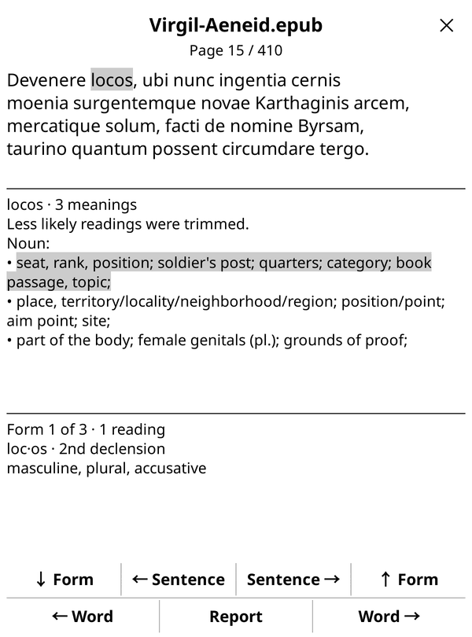
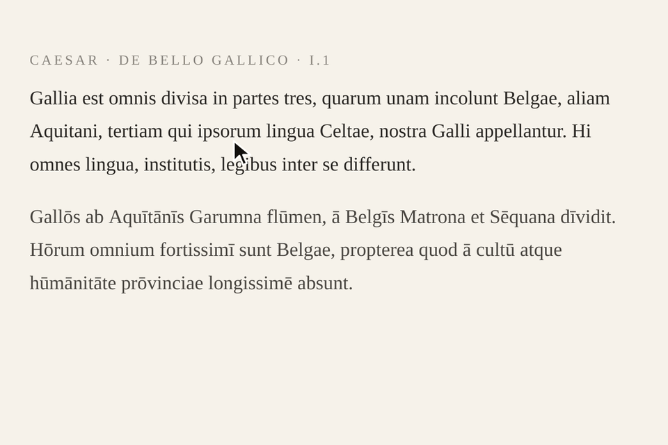

# whitakerLib

[](https://github.com/ddd2951/whitakerLib/actions/workflows/ci.yml)

A small C++23 library that takes a Latin word and returns every reading William
Whitaker's WORDS data supports, with its stem, meaning, part of speech and
inflection, add-ons and Roman numerals included. With a C binding and a Python binding,
both generated from the C++ header.

- **Under a microsecond a word**, on average over [102 Latin books](data/booklist.md#books).
- **1,205,496 spellings, 2,374,470 readings** in a 3.8 MB image embedded in
  the library, with no external data file at runtime, no database and no
  initialization.
- **99.58% of words answered exactly as the Ada WORDS answers them**, every
  reading, record and add-on, in WORDS' order. The [oracle](oracle/README.md)
  explains the comparison.
- **[Try it in your browser](https://ddd2951.github.io/whitakerLib/)**, in the
  [inspector](#the-inspector).

## Why?

whitakerLib started as my own training project. I made it public because I
couldn't find anything that worked like this, with fast lookups, no
dependencies, low memory usage and a compact API.

It isn't meant as an easy tool for translating Latin, but as the backend for
other things, such as running it on a Kindle or another low-resource device.

I'm no Latin expert. I come at this mostly from the programming side, and I
don't think I've figured out anything new. What I have found is that Whitaker
built something that really works. The more I've worked with WORDS, the more
I've come to appreciate how he approached Latin, and his data is genuinely nice
to work with.

Most Latin tools won't need lookups this quick and the generator could have been
written without reflection, but both were fun to build. The reasons why are
given in "Why reflection?" in `codegen/README.md`.

## Built with whitakerLib

- **Kindle and other e-readers**:
  [whitakerLib-kindle](https://github.com/ddd2951/whitakerLib-kindle), a
  KOReader plugin. Tap a word in the sentence you're reading to see its
  readings, offline. About 1,100 lines of Lua, plus the library.
- **Firefox**:
  [whitakerLib-firefox](https://github.com/ddd2951/whitakerLib-firefox), an
  extension. Double-click a Latin word on any page to see its readings,
  offline. Under 600 lines, plus the library built to WebAssembly.

 

I made these two to try the library in two quite different places: a desktop
browser, as WebAssembly, and a Kindle from 2015. If it runs well in both, I
figure it should work in plenty of other places too.

I'm not planning any other apps myself, but I want to keep updating these two,
mostly to find where the library is awkward to use or needs too much
boilerplate. The plan is to move parts of both plugins into the library over
time, so it does those things itself instead of each plugin working around it.
The grammar names in 0.4.1 are the first of these.

## The inspector

A page I built to test the library and find its bottlenecks. Paste some Latin
and move through every reading, with the API output (C++, C or Python) and the
lookup trace. It's online at
[ddd2951.github.io/whitakerLib](https://ddd2951.github.io/whitakerLib/), runs
fully in the page as WebAssembly, and sends nothing.

## Arma virumque cano

The first three words of the *Aeneid*. This is how the library reads them.

- **arma** is "arms, weapons", as nominative, vocative or accusative plural,
  or the imperative of *armo*, "arm!"
- **virumque** loses the tackon *-que*, "and", leaving *virum*, read as *vir*,
  "man, hero", alongside *virus* and the old genitive plural of
  *vis*, "strength".
- **cano** is "I sing", but also the dative or ablative of *canus*, "gray hair,
  old age", of *canum*, "wicker basket", and of the adjective *canus*,
  "white, hoary".

So as far as single words go, Virgil might be singing of arms and the man, or
telling you to arm the man for the wicker basket. Or for old age. Or for the
white one. *cano* won't say which. The library gives you every reading.

Choosing between them is left to whatever sits on top. My approach has been to
make getting the readings so fast that a reader, a ranker or a parser can work
with all of them, and with everything else the library gives. Every reading of
all 63,398 words in the *Aeneid* takes a Kindle Paperwhite from 2015 about a
second.

## API

The project is pre-1.0 and its ABI is not frozen. Until 0.5.0, existing C++
calls and fields won't be removed or changed, but new ones may be added.
0.4.1 is an exception. The grammar values were renamed (`Case::NOM` is now
`Case::nominative`), but kept their numbers.
`include/whitaker.hpp` is C++23, and it opens with what every call promises.

```cpp
whitaker::Result result;
if (whitaker::analyze(result, "amoque") != whitaker::Status::ok)
  return 1;
const whitaker::WordId word{0};
for (std::size_t r = 0; r < whitaker::readingCount(result, word); ++r) {
  const whitaker::ReadingDetail detail = whitaker::detail(result, word, r);
  // detail.dictionaryWord, detail.meaning, detail.form.grammar, detail.form.stemSpelling, ...
}
```

The data is plain data and the functions are free functions. `Result` is the one
owner, holding a batch's words and readings, and everything else reads it.

- `analyze()` replaces the result, and `append()` adds one word. Unknown words
  return `ok` with no readings, words longer than 24 bytes return `inputTooLong`,
  and when memory runs out, `outOfMemory`. `clear()` keeps the capacity.
- A word is a `WordId`, its place in the result. `spelling()`, `trimmed()`,
  `readings()` and `readingCount()` take one, and past the last word they give
  the empty value.
- A reading is stored as 8 bytes of plain data (`latin::packed::Reading`, what
  `readings()` gives), plus a change record for a reading that has one (syncope,
  add-ons, a respelling). `detail(result, word, readingIndex)` decodes one only
  when you ask, into a `ReadingDetail` (160 bytes today): its `dictionaryWord`
  (what the dictionary says of the word, which no ending changes), its `form`
  (stem, ending and grammar), and its meaning and add-ons.
- `rows(result)` is the whole batch as a table, one row per reading, a standard
  view over the result.
- What a call lends goes stale on the next `analyze`, `append` or `clear`, and
  strings returned as `const char*` belong to the library. Different results run on
  different threads in parallel.

Grammar values are named in the reader's words (`Case::nominative`), and
`label()` gives one as text ("future perfect"). The generated
`<latin_generated.hpp>` companion gives Latin names and grammar descriptions,
and `addonSpelling()`, `addonMeaning()` and `spellingRule()` describe the ids a
reading carries.

### C and Python

Both are generated from the C++ header's `WHITAKER_TAG(bind)` tags by `codegen`,
with the same fields by the same names, and the build refuses to run while
either is out of date with the header. For now, the inspector is the place to
see them. Its API view shows every call and every field of a reading as C++, C
or Python. Unlike the C++ API, the bindings may still change before 0.5.0. There
is no WebAssembly binding yet, since the inspector builds the library to
WebAssembly for itself.

## Limitations

- One word per call, with no tokenizing, parsing, ranking or translation.
- ASCII only. Case-insensitive, and `j` folds with `i` and `v` with `u`, except
  in Roman numerals and, as in WORDS, in the syncope pass. Long marks and
  ligatures are left to the caller.
- No headword yet. Each reading names its dictionary word, and `stems()` gives
  that word's stems, but the citation form (*amo, amare, amavi, amatus*) isn't
  built. `form.stemSpelling` is the matched stem and `form.ending` the ending
  after it (`am` + `o`).
- WORDS' word-split and bad Roman numeral guesses are not implemented.

## Speed and accuracy

Both were measured over the same [102 Latin books](data/booklist.md#books),
totaling 4,662,505 word occurrences.

**Speed.** On one thread, the C++ example (`examples/cpp`) analyzes the
4,662,505 words, then decodes and describes every one of their 17,460,251
readings, in 3.53 s, or 0.76 µs a word. On the CPU's 12 threads it takes 0.49 s.
Reading the files and splitting them into words is not timed. Finding a word's
readings alone, without decoding them, takes 421 ns a word natively and 610 ns
in WebAssembly under Node. Ryzen 5 5600X, GCC 16, a Release build.

**On a Kindle.** The library runs on a Kindle Paperwhite 3 from 2015 (Cortex-A9,
about 1 GHz), cross-compiled with Clang as a Release build targeted at its CPU
(`-O3 -mcpu=cortex-a9 -mfpu=neon`), with no other tuning. On 200,000 words
evenly spaced through the books, it looks up each word and decodes every reading
in 2.56 s on one thread, 12.8 µs a word. The lookup alone takes 8.8 µs. It
returns the same 750,215 readings as the PC. The KOReader plugin runs on it
there (see [Built with whitakerLib](#built-with-whitakerlib)).

**Accuracy.** Every word is compared with the answer from the Ada WORDS
program, built using the same data, down to each reading with its stem, each
dictionary record and meaning, the add-ons, and the order of all of them.

**99.58%** of the words (97.35% of the distinct spellings) get exactly WORDS'
answer. The [book list](data/booklist.md#books) gives the per-book results, and
the [oracle README](oracle/README.md#where-we-are-now) explains the remaining
differences. That comparison uses the patched WORDS revision `5dd8ca5`,
described in the [oracle README](oracle/README.md#bugs-found-in-words).

Tracking down where the two disagree turned up several bugs in WORDS itself,
some of which crashed it.

## Inside

From WORDS' files to a reading, in five steps.

1. `codegen` reads WORDS' four files: DICTLINE, INFLECTS, UNIQUES and ADDONS.
2. It expands every stem with every ending it takes, into the readings WORDS
   would give.
3. It packs them into the image, and checks the image's lookup against the
   expansion on every spelling.
4. At run time, `analyze()` looks each word up in the image, and runs WORDS'
   passes (add-ons, syncope, respellings) for what the image alone can't answer.
5. `detail()` decodes a reading only when you ask for it.

How much to pack into the image and how much to leave to run time has been one
of the most fun parts of this project. Moving even a small part of the work
into the image can make it explode in size, so it's a matter of finding a good
middle ground. In one experiment I tried with every finished spelling in the image,
enclitics included, it grew to about 93 MB. With prefixes and suffixes added
it passed 1 GB before it was even a tenth done, so those stay at run time.

`codegen/README.md` describes steps 1 to 3, and `src/whitaker.cpp` is where
step 4 starts, with WORDS' passes in WORDS' order.

## Build

Tested on Linux only. It needs CMake 3.21, GCC 15 or Clang 20 (for `#embed`
in C++, with its offset parameter). Callers use C++23 and `whitaker.hpp`, or C11
and `whitaker.h`.

```sh
cmake -S . -B build -DCMAKE_BUILD_TYPE=Release
cmake --build build -j
cmake --install build --prefix /your/prefix
```

The options are `WHITAKER_SANITIZE` (ASan and UBSan), `WHITAKER_BUILD_PYTHON` (needs
pybind11), and `WHITAKER_INSTALL` and `WHITAKER_WERROR`, which are on when
whitakerLib is the top-level project and off under `add_subdirectory()`.

The install provides a CMake package and a relocatable `whitaker.pc`.

```cmake
find_package(Whitaker CONFIG REQUIRED)
target_link_libraries(your_target PRIVATE Whitaker::whitaker)
```

`bindings/c` and `bindings/python` are generated from the header, and
`inspector/` is built with Emscripten (`emcmake cmake`). `examples/cpp` reads on
several threads and compares them with one thread, and `examples/c` prints every
reading of the words given.

## Contributing

**Words.** If the library reads a word from a book differently than WORDS
does, open an issue or a pull request. A link to the book, or a picture of the
page with the word on it, is enough.

**Code.** Anything that makes it faster or smaller is welcome, as long as I
can understand it. I'm not strict on style either. If you know a cool trick,
show me. How you got there doesn't matter, AI included, as long as you
understand the change you're sending.

## Data and licence

The data is from Colonel William Whitaker's WORDS, revision `1f2f0fb0867a`
(2026-08-26) of
[`mk270/whitakers-words`](https://github.com/mk270/whitakers-words), the files
`DICTLINE.GEN`, `INFLECTS.LAT`, `UNIQUES.LAT` and `ADDONS.LAT`, unmodified.
They are not shipped. `data/source/MANIFEST.sha256` holds their hashes and
`codegen/README.md` says how to fetch them, which only regenerating the image needs.

`data/whitaker.dat`, the image, is checked in, so a build cannot change it
silently. `codegen/README.md` says how it is made and checked.

The library is under the European Union Public Licence v. 1.2 (`LICENSE`).
The WORDS data is a separate work under Whitaker's notice
(`data/source/LICENCE.txt`).

A big thanks to William Whitaker for making his program available. Not all of
it has aged like fine wine, but I think the systems underneath it make sense
for Latin.

And an equally big thanks to [mk270](https://github.com/mk270) for keeping it
well maintained, and for making sure a program of that age still moves forward.
Writing a program is one thing. Understanding someone else's well enough to
carry it forward, with respect for what they built, is another, and it doesn't
get the credit it deserves.
